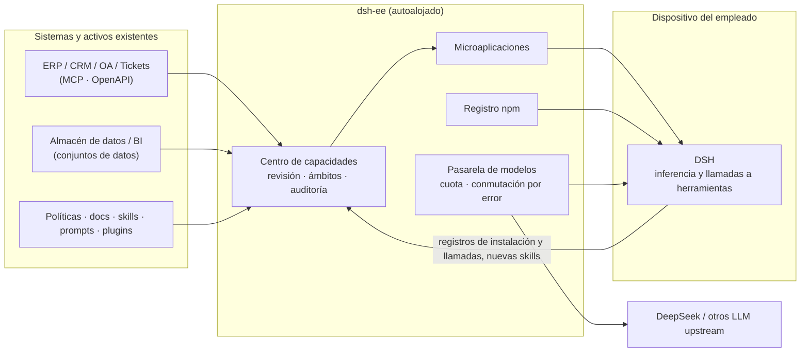

<div align="center">

# dsh-ee

**Tu empresa, dentro del Harness de cada empleado**

Conecta tu ERP, CRM, almacén de datos y documentos de políticas, conviértelos en microaplicaciones de IA,<br>
y llévalos, revisados y con permisos, al [DeepSeek Harness (DSH)](https://github.com/deepseek-ai/deepseek-harness) de cada empleado.<br>
Los datos y las credenciales se quedan en tu propio servidor, y cada llamada se puede auditar.

[English](./README.md) · [简体中文](./README.zh-CN.md) · Español · [Português](./README.pt.md) · [हिन्दी](./README.hi.md)

[](./LICENSE)

### [→ Prueba la demo en vivo, sin instalar nada](https://demo.hikariming.com/)


</div>

## Pruébalo

Abre [demo.hikariming.com](https://demo.hikariming.com/) y elige a un empleado de la empresa de ejemplo, Xinghe Tech. No hace falta registrarse:

- **Zhou Hang, gestor de cuentas**: consulta sus clientes, qué contratos están a punto de vencer y quién necesita una visita en *Informe de visitas a clientes*
- **Chen Yi, contable de gastos**: revisa las solicitudes de gastos y detecta hoteles por encima del límite y facturas duplicadas en *Asistente de gastos de viaje*
- **Zheng Xiaoyu, nueva incorporación**: consulta qué hacer en su primera semana en *Compañero de incorporación*
- **Liu Yang, responsable de TI**: revisa la cola de tickets y los problemas habituales en *Servicio de soporte de TI*

También puedes iniciar sesión como administrador (la cuenta aparece en la página de inicio de sesión) para ver cómo se conectan los sistemas, cómo se revisan y autorizan las aplicaciones y cómo queda registrada cada llamada.

Los datos de la empresa de ejemplo están en chino.

**¿Ya tienes DSH?** Ejecuta `curl -fsSL https://demo.hikariming.com/setup.sh | sh` (en Windows, `irm https://demo.hikariming.com/setup.ps1 | iex`), elige a un empleado en el navegador para aprobar el inicio de sesión y luego escribe `/customer-brief` en DSH y pide un informe de visita sobre 华东精密制造. La demo no proporciona un modelo: DSH usa el que ya tengas configurado.

## Tres escenarios

| Quién | Qué pregunta en DSH | Qué hace la IA |
|---|---|---|
| Gestor de cuentas | «Huadong Precision renueva la semana que viene. ¿A qué debería prestar atención?» | Llama al CRM: el contrato vence dentro de 21 días y no ha habido visitas en 75 días. Consulta la documentación del producto: las renovaciones tienen como máximo un 10 % de descuento, y cualquier descuento mayor necesita la aprobación del director de ventas |
| Contable de gastos | «¿Hay algún problema en las solicitudes de gastos de este mes?» | Llama al sistema de viajes, enumera las 4 solicitudes marcadas y explica cada una según la política de viajes |
| Nueva incorporación | «El VPN no conecta, da error de certificado» | Recorre la guía de resolución de problemas de TI paso a paso y, si eso no lo soluciona, abre un ticket (después de pedirte confirmación) |

## Para quién es

- **Para**: empresas de entre decenas y miles de personas cuyos empleados usan o van a usar DeepSeek / DSH, que quieren que la IA trabaje con sus propios sistemas y conocimientos, y que se preocupan por las filtraciones de datos, los accesos sin control y las llamadas que nadie puede rastrear.
- **No es para**: uso personal; equipos que solo quieren un chat en el navegador; empresas que no tienen previsto que sus empleados instalen DSH en sus propias máquinas.

## Por qué dsh-ee

Las herramientas de IA son fáciles de conseguir. Lo que falta a las empresas es una forma segura de poner **su propio** conocimiento y sus propios sistemas en manos de cada empleado.

| Empleados que usan herramientas de IA por su cuenta | Con dsh-ee |
|---|---|
| Las políticas y las definiciones de métricas se copian y se pegan en los chats a mano | Las políticas, los sistemas y los datos se convierten en capacidades que funcionan en cuanto se instalan |
| Los plugins y las skills vienen de fuentes desconocidas y nadie los revisa antes de instalarlos | Cada paquete pasa por comprobaciones automáticas y la aprobación del administrador, y el acceso se concede por departamento |
| No hay registro de quién llamó a qué sistema desde qué máquina | Las instalaciones y las llamadas se escriben en el registro de auditoría, y cualquier cosa se puede retirar con un clic |
| Los prompts y flujos de trabajo útiles se quedan en el portátil de una sola persona | Las skills que crean los empleados vuelven al ámbito de la empresa para que todos las reutilicen |

dsh-ee no es un entorno de ejecución de IA. **La inferencia y las llamadas a herramientas se ejecutan en el DSH local de cada empleado.** dsh-ee prepara y gobierna todo lo que DSH necesita: capacidades, conexiones, datos, modelos y políticas.

## Funciones

- **Centro de capacidades**: plugins, skills, prompts, conexiones empresariales y microaplicaciones se gestionan en un solo lugar. Cada elemento tiene versiones, un ámbito de acceso (departamento, rol o persona) y un modo de entrega (activación automática o suscripción voluntaria). Las capacidades habilitadas se sincronizan automáticamente con el DSH de los empleados.
- **Microaplicaciones**: una persona de IA, un área de trabajo y unos ingredientes (bases de conocimiento, conexiones, skills y prompts), con tablas propias opcionales. Los empleados las abren en DSH con `/nombre`; también se pueden publicar como páginas web que funcionan en el móvil.
- **Conexiones empresariales (pasarela MCP)**: integra ERP, CRM, sistemas de tickets y otros sistemas internos como servidores MCP o especificaciones OpenAPI. Las credenciales se cifran y se guardan en el servidor, y nunca se envían a las máquinas de los empleados. Cada herramienta se autoriza por separado y cada llamada queda registrada.
- **Hub de datos**: conjuntos de datos compartidos en una base de datos aparte, consultados mediante una cuenta de solo lectura, con parámetros por usuario como `:me_department`. Los datos de referencia compartidos (clientes, personas, productos y demás) viven en un solo lugar.
- **Base de conocimiento**: preguntas y respuestas en las que cada respuesta cita sus fuentes, sin base de datos vectorial. Un agente hace varias rondas de búsqueda por palabras clave y lee los documentos originales. Admite PDF, Word y Markdown, con versiones y reversión.
- **Registro npm integrado con revisión**: alojamiento y publicación para el ámbito de la empresa, revisión de cada versión y comprobaciones automáticas de scripts de instalación, dependencias, licencias y secretos filtrados. El ámbito de la empresa nunca recurre al registro público, lo que bloquea la confusión de dependencias (dependency confusion). Admite la precarga de paquetes desde un upstream y la importación y exportación de paquetes offline.
- **Pasarela de modelos compatible con OpenAI**: conecta DeepSeek o cualquier otro upstream compatible con OpenAI y expón un único conjunto de nombres de modelo. Un modelo puede residir en varios upstreams con conmutación por error automática. Cada cuenta recibe una cuota mensual de tokens y una lista de modelos permitidos.
- **Incorporación con un solo comando**: ejecuta `curl -fsSL <dsh-ee>/setup.sh | sh` (o `irm <dsh-ee>/setup.ps1 | iex` en Windows) y confirma un código de dispositivo en el navegador. Un único token unificado (`ee_at_…`) configura después el registro npm, los modelos y el centro de capacidades.
- **Acceso de Harness de terceros**: registra un cliente de API (`client_id` / `client_secret`) por integración; la CI u otro Harness lo canjea por un token `ee_at_` de corta duración mediante `client_credentials` en lugar de guardar un token de administrador. Los scopes están limitados por la cuenta propietaria, el secreto se guarda como hash y se muestra una sola vez, y cada canje queda auditado.
- **Identidad y gobernanza**: cuentas locales además de LDAP / AD, RBAC, menús editables en tiempo de ejecución, registro de auditoría y analíticas desglosadas por departamento, capacidad, modelo y endpoint.
- **Funciona en infraestructura nacional**: un único binario estático de Go para linux/amd64 y arm64. Funciona sobre OceanBase o TiDB y trabaja totalmente offline.

## Arquitectura

<picture>
  <source media="(prefers-color-scheme: dark)" srcset="docs/images/hero-dark.png">
  
</picture>



dsh-ee es **un solo binario**: la interfaz web va incrustada y un único puerto sirve la interfaz, las API (`/api`, `/v1`, `/mcp`), el registro npm (`/npm/`) y el índice de plugins de DSH (`/index/dsh-index.json`). Necesita una base de datos con protocolo MySQL (**OceanBase** en modo MySQL o **TiDB**) y un directorio de datos.

## Inicio rápido

### Paquete offline (recomendado)

La máquina de destino solo necesita Docker y Docker Compose v2. No hace falta conexión a internet.

```bash
tar xzf dsh-ee-<version>-linux-amd64.tar.gz && cd dsh-ee-<version>-linux-amd64
sha256sum -c SHA256SUMS

./install.sh tidb        # dsh-ee + TiDB de nodo único
./install.sh oceanbase   # dsh-ee + OceanBase de nodo único (el host necesita 2 núcleos / 8 GB+)
./install.sh external    # solo dsh-ee; define DSH_EE_DSN en .env antes
```

La primera ejecución genera `.env` (clave maestra y contraseña inicial del administrador) e imprime la contraseña del administrador. **Haz una copia de seguridad de `.env` junto con la base de datos.** Si pierdes la clave maestra, las credenciales de upstream guardadas ya no se podrán descifrar.

Puedes crear tu propio paquete con `make bundle VERSION=v0.1.0 ARCH=amd64` (o `ARCH=arm64`).

### Docker Compose

```bash
cd deploy
cp ../server/.env.example .env   # define DSH_EE_SECRET_KEY (openssl rand -base64 32), etc.
docker build -t dsh-ee:latest ..
docker compose -f compose.yml -f compose.tidb.yml up -d
```

### Sin Docker

```bash
make build                       # → dist/dsh-ee (interfaz web incrustada)
DSH_EE_DSN='root:@tcp(127.0.0.1:4000)/dsh_ee' \
DSH_EE_SECRET_KEY="$(openssl rand -base64 32)" \
DSH_EE_BOOTSTRAP_ADMIN_PASSWORD='change-me-please' \
./dist/dsh-ee
```

Hay una unidad de systemd en [`deploy/systemd`](./deploy/systemd). HTTPS, los proxies inversos y la base de datos del hub de datos se tratan en [deploy/README.md](./deploy/README.md) (en chino).

### Conectar a los empleados

En la máquina de cada empleado:

```bash
curl -fsSL https://<dsh-ee>/setup.sh | sh     # macOS / Linux
irm https://<dsh-ee>/setup.ps1 | iex          # Windows
```

Confirma el código de dispositivo en el navegador y DSH quedará conectado a las capacidades y los modelos de la empresa. Dentro de DSH, `/ee-login`, `/ee-status` y `/ee-logout` gestionan la sesión.

## Configuración

| Variable | Descripción |
|---|---|
| `DSH_EE_DSN` | **Obligatorio.** DSN con protocolo MySQL; la base de datos se crea si no existe |
| `DSH_EE_SECRET_KEY` | **Obligatorio.** Clave maestra de 32 bytes en base64 que se usa para cifrar las credenciales de upstream |
| `DSH_EE_ADDR` | Dirección de escucha, por defecto `127.0.0.1:8080` |
| `DSH_EE_BOOTSTRAP_ADMIN` / `_PASSWORD` | Administrador que se crea cuando la tabla de usuarios está vacía (usuario por defecto `admin`) |
| `DSH_EE_PUBLIC_URL` | URL pública, p. ej. `https://dsh.example.internal`; a partir de ella se generan las URL de los tarballs npm |
| `DSH_EE_COOKIE_SECURE` | Fuerza la marca `Secure` en la cookie de sesión; por defecto está activada cuando `DSH_EE_PUBLIC_URL` es `https://…` |
| `DSH_EE_DATA_DIR` | Directorio de datos (tarballs npm, cachés), por defecto `./data` |
| `DSH_EE_DATA_DSN` / `DSH_EE_DATA_READ_DSN` | Base de datos del hub de datos (escritura / solo lectura); `off` desactiva el hub de datos |
| `DSH_EE_LOGIN_IP_LIMIT` / `DSH_EE_LOGIN_IP_WINDOW` | Inicios de sesión fallidos permitidos por IP de cliente en una ventana fija, por defecto `50` cada `15m`; `0` / `off` lo desactiva |
| `DSH_EE_METRICS` | Defínelo como `true` para exponer `GET /metrics` (formato de texto de Prometheus, solo loopback / redes internas); desactivado por defecto |
| `DSH_EE_CSP` | Modo de Content-Security-Policy: `off` (por defecto; solo la protección de incrustación `frame-ancestors` existente), `report` (`Content-Security-Policy-Report-Only`, solo informa) o `enforce` (`Content-Security-Policy`, bloquea las infracciones). Los hashes de los scripts inline se calculan al arrancar a partir del `index.html` incrustado; `frame-ancestors` se combina con `DSH_EE_EMBED_ORIGINS`. Los valores no válidos hacen fallar el arranque. Consulta [docs/operations.md](./docs/operations.md) §10.1 |
| `DSH_EE_CSP_REPORT_URI` | URL opcional para los informes de infracción de CSP (`http(s)://…`); se añade como `report-uri` cuando `DSH_EE_CSP` no es `off`. dsh-ee no incluye un recolector |
| `DSH_EE_TRUSTED_PROXIES` | IP/CIDR de proxies inversos (separadas por comas) cuyas cabeceras `X-Forwarded-*` se aceptan; por defecto, solo loopback. Defínelo cuando el proxy se ejecute en otro contenedor u host o detrás de un LB en la nube |
| `DSH_EE_REFRESH_TOKENS` | Tokens de refresco opcionales al estilo OAuth (rotación de un solo uso y detección de reutilización); desactivado por defecto, así que el comportamiento de los clientes no cambia. Al activarlo, la emisión por dispositivo o manual también devuelve un token de refresco `ee_rt_` y `POST /api/auth/refresh` queda disponible (404 mientras está desactivado). Consulta [docs/token-lifecycle.md](./docs/token-lifecycle.md) §3 |
| `DSH_EE_REFRESH_ACCESS_TTL` / `_TOKEN_TTL` / `_FAMILY_TTL` / `_GRACE` | TTL de los tokens de refresco y margen de rotación: acceso `1h`, refresco inactivo `720h`, tope por familia `4320h`, margen `0` (estricto) por defecto |

La lista completa está en [server/README.md](./server/README.md).

## Desarrollo

Requisitos: **Go 1.27+**, **Node 22** con **pnpm** y un TiDB u OceanBase local.

```bash
# 1. Base de datos: TiDB de nodo único
tiup playground v8.5.8 --tag dsh-ee --tiflash 0 --without-monitor --host 127.0.0.1

# 2. Servidor (crea el esquema y el administrador en el primer arranque)
cd server
cp .env.example .env.local        # rellena DSH_EE_SECRET_KEY y la contraseña del administrador
set -a; . ./.env.local; set +a
go run ./cmd/dsh-ee

# 3. Interfaz web (hace proxy de /api, /v1, /npm y /index a :8080)
cd web
pnpm install
pnpm dev                          # http://localhost:5188

# 4. Opcional: datos de demostración (roles, empleados, cuotas, upstreams y una microaplicación de ejemplo)
cd server && go run ./cmd/seed
```

### Pruebas

```bash
DSH_EE_TEST_DSN='root:@tcp(127.0.0.1:4000)/' make test   # pruebas de integración de Go (base de datos aleatoria por prueba)
E2E_BASE=http://127.0.0.1:8080 ADMIN_PW=… make e2e      # pruebas de extremo a extremo con Playwright
cd dsh-plugin && npm test                                # plugin de conexión de DSH
```

La CI (`.github/workflows/ci.yml`) compila la interfaz, ejecuta las pruebas de Go contra TiDB, ejecuta la suite de extremo a extremo contra la compilación en un solo archivo y construye la imagen. Un flujo de trabajo `oceanbase` aparte repite esto sobre OceanBase.

### Estructura del repositorio

| Ruta | Contenido |
|---|---|
| [`server/`](./server) | Servidor Go: autenticación, RBAC, LDAP, pasarela de modelos, registro npm, centro de capacidades, pasarela MCP, base de conocimiento, hub de datos |
| [`web/`](./web) | Interfaz Vite + React + Tailwind (shadcn/ui), en chino e inglés |
| [`dsh-plugin/`](./dsh-plugin) | `dsh-connect`, el plugin de DSH que conecta un cliente a dsh-ee |
| [`deploy/`](./deploy) | Archivos de Compose, instalador offline, unidad de systemd |
| [`e2e/`](./e2e) | Pruebas de Playwright y escenarios con DSH real |
| [`docs/`](./docs) | Documentos de diseño (en chino) |

## Estado

dsh-ee está en desarrollo temprano (v0.x). Las API y los esquemas pueden cambiar entre versiones. Lagunas conocidas:

- El inicio de sesión OIDC está disponible en cuanto un administrador configura un proveedor de identidad; las cuentas locales y LDAP / AD también funcionan.
- La distribución de DSH Desktop lee los canales de release oficiales, verifica sha512 y puede replicar los instaladores en local.
- Orientado a una sola instancia: los límites de intentos de inicio de sesión, las cachés y los trabajos de precarga se guardan en la memoria del proceso, y los tarballs en el disco local.

Consulta la sección «Known limitations» de [server/README.md](./server/README.md) para más detalles.

## Contribuciones

Los issues y pull requests son bienvenidos. Ejecuta las pruebas correspondientes antes de abrir un PR. Los textos de la interfaz están en `web/src/i18n/{zh,en}`; el archivo en inglés debe reflejar la estructura del chino, y las claves que faltan hacen fallar `tsc`.

## Licencia

[Apache License 2.0](./LICENSE)

dsh-ee es un proyecto independiente y no está afiliado a DeepSeek.
