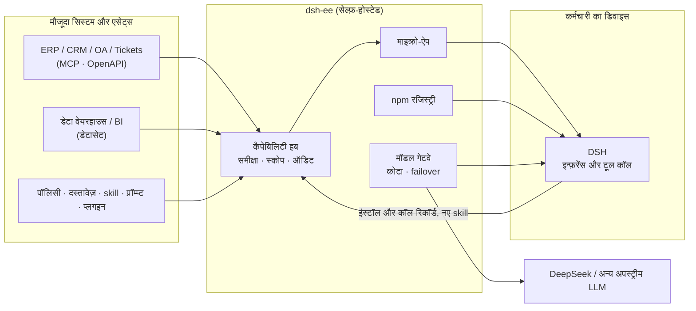

<div align="center">

# dsh-ee

**आपकी कंपनी, हर कर्मचारी के Harness के अंदर**

अपना ERP, CRM, डेटा वेयरहाउस और पॉलिसी दस्तावेज़ जोड़ें, उन्हें AI माइक्रो-ऐप में तैयार करें,<br>
और हर कर्मचारी के [DeepSeek Harness (DSH)](https://github.com/deepseek-ai/deepseek-harness) तक समीक्षा और अनुमति के बाद पहुँचाएँ।<br>
डेटा और क्रेडेंशियल आपके ही सर्वर पर रहते हैं, और हर कॉल का ऑडिट किया जा सकता है।

[English](./README.md) · [简体中文](./README.zh-CN.md) · [Español](./README.es.md) · [Português](./README.pt.md) · हिन्दी

[](./LICENSE)

### [→ लाइव डेमो आज़माएँ, कुछ भी इंस्टॉल करने की ज़रूरत नहीं](https://demo.hikariming.com/)


</div>

## इसे आज़माएँ

[demo.hikariming.com](https://demo.hikariming.com/) खोलें और सैंपल कंपनी Xinghe Tech के किसी कर्मचारी को चुनें। रजिस्टर करने की ज़रूरत नहीं:

- **Zhou Hang, अकाउंट मैनेजर**: *ग्राहक विज़िट ब्रीफ़* में अपने ग्राहक, कौन-से कॉन्ट्रैक्ट जल्द खत्म होने वाले हैं और किसे विज़िट की ज़रूरत है, देखें
- **Chen Yi, खर्च लेखाकार**: *यात्रा खर्च सहायक* में खर्च के दावे जाँचें और सीमा से ज़्यादा के होटल तथा डुप्लिकेट इनवॉइस पहचानें
- **Zheng Xiaoyu, नई भर्ती**: *ऑनबोर्डिंग साथी* में देखें कि पहले हफ़्ते क्या करना है
- **Liu Yang, IT प्रमुख**: *IT सर्विस डेस्क* में टिकटों का बैकलॉग और आम समस्याएँ देखें

आप एडमिन के तौर पर भी साइन इन कर सकते हैं (अकाउंट साइन-इन पेज पर है) और देख सकते हैं कि सिस्टम कैसे जुड़ते हैं, ऐप्स की समीक्षा और अनुमति कैसे होती है, और हर कॉल कैसे लॉग होती है।

सैंपल कंपनी का डेटा चीनी में है।

**DSH पहले से है?** `curl -fsSL https://demo.hikariming.com/setup.sh | sh` चलाएँ (Windows पर `irm https://demo.hikariming.com/setup.ps1 | iex`), ब्राउज़र में किसी कर्मचारी को चुनकर साइन-इन की अनुमति दें, फिर DSH में `/customer-brief` टाइप करें और 华东精密制造 के बारे में विज़िट ब्रीफ़ माँगें। डेमो कोई मॉडल नहीं देता: DSH वही मॉडल इस्तेमाल करता है जो आपने पहले से सेट किया है।

## तीन परिदृश्य

| कौन | DSH में क्या पूछता है | AI क्या करता है |
|---|---|---|
| अकाउंट मैनेजर | “Huadong Precision अगले हफ़्ते रिन्यू हो रहा है। मुझे किन बातों का ध्यान रखना चाहिए?” | CRM कॉल करता है: कॉन्ट्रैक्ट 21 दिनों में खत्म हो रहा है और 75 दिनों से कोई विज़िट नहीं हुई। प्रोडक्ट दस्तावेज़ देखता है: रिन्यूअल पर ज़्यादा से ज़्यादा 10% छूट मिलती है, और उससे ज़्यादा के लिए सेल्स डायरेक्टर की मंज़ूरी ज़रूरी है |
| खर्च लेखाकार | “इस महीने के खर्च के दावों में कोई दिक्कत है?” | ट्रैवल सिस्टम कॉल करता है, 4 फ़्लैग किए गए दावे गिनाता है, और ट्रैवल पॉलिसी के हिसाब से हर एक की वजह समझाता है |
| नई भर्ती | “VPN कनेक्ट नहीं हो रहा, सर्टिफ़िकेट एरर आ रहा है” | IT ट्रबलशूटिंग गाइड के हिसाब से कदम-दर-कदम जाँचता है, और अगर उससे हल न हो तो टिकट बनाता है (पहले आपसे पुष्टि माँगकर) |

## यह किसके लिए है

- **इनके लिए**: दर्जनों से हज़ारों कर्मचारियों वाली कंपनियाँ जिनके कर्मचारी DeepSeek / DSH इस्तेमाल करते हैं या करने वाले हैं, जो चाहती हैं कि AI उनके अपने सिस्टम और ज्ञान के साथ काम करे, और जिन्हें डेटा लीक, बेकाबू एक्सेस और ऐसी कॉल्स की चिंता है जिनका कोई रिकॉर्ड न हो।
- **इनके लिए नहीं**: निजी इस्तेमाल; ऐसी टीमें जिन्हें बस ब्राउज़र में चैट पेज चाहिए; ऐसी कंपनियाँ जो कर्मचारियों के कंप्यूटर पर DSH इंस्टॉल नहीं कराना चाहतीं।

## dsh-ee क्यों

AI टूल मिलना आसान है। कंपनियों के पास जो कमी है वह है **अपना** ज्ञान और अपने सिस्टम हर कर्मचारी तक सुरक्षित तरीके से पहुँचाने का रास्ता।

| कर्मचारी अपने-अपने तरीके से AI टूल इस्तेमाल करें तो | dsh-ee के साथ |
|---|---|
| पॉलिसी और मीट्रिक की परिभाषाएँ हाथ से कॉपी-पेस्ट करके चैट में डालनी पड़ती हैं | पॉलिसी, सिस्टम और डेटा ऐसी क्षमताओं में बदल जाते हैं जो इंस्टॉल होते ही काम करने लगती हैं |
| प्लगइन और skill अनजान स्रोतों से आते हैं, और इंस्टॉल से पहले कोई समीक्षा नहीं करता | हर पैकेज ऑटोमेटेड जाँच और एडमिन की मंज़ूरी से गुज़रता है, और एक्सेस विभाग के हिसाब से दिया जाता है |
| किसने किस मशीन से किस सिस्टम को कॉल किया, इसका कोई रिकॉर्ड नहीं | इंस्टॉल और कॉल ऑडिट लॉग में दर्ज होते हैं, और कुछ भी एक क्लिक में अनपब्लिश किया जा सकता है |
| काम के प्रॉम्प्ट और वर्कफ़्लो किसी एक व्यक्ति के लैपटॉप तक सीमित रह जाते हैं | कर्मचारियों के बनाए skill कंपनी स्कोप में वापस आते हैं, जहाँ सब उन्हें दोबारा इस्तेमाल कर सकते हैं |

dsh-ee कोई AI रनटाइम नहीं है। **इन्फ़रेंस और टूल कॉल हर कर्मचारी के लोकल DSH में चलते हैं।** dsh-ee वह सब तैयार और नियंत्रित करता है जो DSH को चाहिए: क्षमताएँ, कनेक्शन, डेटा, मॉडल और पॉलिसी।

## फ़ीचर

- **कैपेबिलिटी हब**: प्लगइन, skill, प्रॉम्प्ट, एंटरप्राइज़ कनेक्शन और माइक्रो-ऐप एक ही जगह मैनेज होते हैं। हर एक के वर्ज़न, एक्सेस स्कोप (विभाग, रोल या व्यक्ति) और डिलीवरी मोड (अपने आप चालू या खुद चालू करना) होते हैं। चालू क्षमताएँ कर्मचारियों के DSH में अपने आप सिंक होती हैं।
- **माइक्रो-ऐप**: एक पर्सोना, एक वर्कबेंच और सामग्री (नॉलेज बेस, कनेक्शन, skill, प्रॉम्प्ट), साथ में वैकल्पिक ऐप-स्पेसिफ़िक टेबल। कर्मचारी उन्हें DSH में `/name` से खोलते हैं; ऐप्स को ऐसे वेब पेज के रूप में भी पब्लिश किया जा सकता है जो मोबाइल पर चलते हैं।
- **एंटरप्राइज़ कनेक्शन (MCP गेटवे)**: ERP, CRM, टिकटिंग और दूसरे अंदरूनी सिस्टम MCP सर्वर या OpenAPI स्पेक के रूप में जोड़ें। क्रेडेंशियल एन्क्रिप्ट होकर सर्वर पर रहते हैं, कर्मचारियों की मशीनों पर कभी नहीं भेजे जाते। हर टूल को अलग से अनुमति मिलती है, और हर कॉल लॉग होती है।
- **डेटा हब**: साझा डेटासेट अलग डेटाबेस में, सिर्फ़-पढ़ने वाले अकाउंट से क्वेरी किए जाते हैं, साथ में `:me_department` जैसे प्रति-यूज़र पैरामीटर। ग्राहक, लोग, प्रोडक्ट और दूसरा साझा रेफ़रेंस डेटा एक ही जगह रहता है।
- **नॉलेज बेस**: ऐसा प्रश्नोत्तर जहाँ हर जवाब अपने स्रोत बताता है, बिना किसी वेक्टर डेटाबेस के। एक एजेंट कीवर्ड खोज के कई राउंड करता है और मूल दस्तावेज़ पढ़ता है। PDF, Word और Markdown सपोर्ट हैं, साथ में वर्ज़न और रोलबैक।
- **रिव्यू के साथ बिल्ट-इन npm रजिस्ट्री**: कंपनी स्कोप के लिए होस्टिंग और पब्लिशिंग, हर वर्ज़न की समीक्षा, और इंस्टॉल स्क्रिप्ट, डिपेंडेंसी, लाइसेंस तथा लीक हुए सीक्रेट की ऑटोमेटेड जाँच। कंपनी स्कोप कभी पब्लिक रजिस्ट्री पर वापस नहीं जाता, जिससे dependency confusion रुकता है। अपस्ट्रीम से पैकेज प्रीलोड करना और ऑफ़लाइन बंडल इम्पोर्ट/एक्सपोर्ट सपोर्ट है।
- **OpenAI-संगत मॉडल गेटवे**: DeepSeek या कोई भी OpenAI-संगत अपस्ट्रीम जोड़ें और मॉडल नामों का एक ही सेट बाहर दिखाएँ। एक मॉडल कई अपस्ट्रीम पर रह सकता है, साथ में अपने आप failover। हर अकाउंट को महीने का टोकन कोटा और अनुमत मॉडलों की सूची मिलती है।
- **एक कमांड में ऑनबोर्डिंग**: `curl -fsSL <dsh-ee>/setup.sh | sh` चलाएँ (Windows पर `irm <dsh-ee>/setup.ps1 | iex`) और ब्राउज़र में डिवाइस कोड की पुष्टि करें। इसके बाद एक ही यूनिफ़ाइड टोकन (`ee_at_…`) npm रजिस्ट्री, मॉडल और कैपेबिलिटी हब कॉन्फ़िगर कर देता है।
- **तीसरे पक्ष के Harness का एक्सेस**: हर इंटीग्रेशन के लिए एक API क्लाइंट (`client_id` / `client_secret`) रजिस्टर करें; CI या दूसरा Harness एडमिन टोकन रखने के बजाय `client_credentials` से उसे थोड़ी देर के लिए मान्य `ee_at_` टोकन में बदल सकता है। स्कोप मालिक अकाउंट तक सीमित होते हैं, सीक्रेट हैश के रूप में सिर्फ़ एक बार दिखाया जाता है, और हर एक्सचेंज ऑडिट होता है।
- **पहचान और गवर्नेंस**: लोकल अकाउंट के अलावा LDAP / AD, RBAC, रनटाइम में बदले जा सकने वाले मेन्यू, ऑडिट लॉग, और विभाग, क्षमता, मॉडल तथा endpoint के हिसाब से एनालिटिक्स।
- **घरेलू इन्फ्रास्ट्रक्चर पर चलता है**: linux/amd64 और arm64 के लिए एक ही स्टैटिक Go बाइनरी। OceanBase या TiDB पर चलता है और पूरी तरह ऑफ़लाइन काम करता है।

## आर्किटेक्चर

<picture>
  <source media="(prefers-color-scheme: dark)" srcset="docs/images/hero-dark.png">
  
</picture>



dsh-ee **एक ही बाइनरी** है: वेब UI अंदर एम्बेड होता है, और एक ही पोर्ट UI, API (`/api`, `/v1`, `/mcp`), npm रजिस्ट्री (`/npm/`) और DSH प्लगइन इंडेक्स (`/index/dsh-index.json`) परोसता है। इसके लिए MySQL प्रोटोकॉल वाला डेटाबेस (**OceanBase** MySQL मोड में या **TiDB**) और एक डेटा डायरेक्टरी चाहिए।

## क्विक स्टार्ट

### ऑफ़लाइन बंडल (सुझाया गया)

लक्ष्य मशीन पर सिर्फ़ Docker और Docker Compose v2 चाहिए। इंटरनेट की ज़रूरत नहीं है।

```bash
tar xzf dsh-ee-<version>-linux-amd64.tar.gz && cd dsh-ee-<version>-linux-amd64
sha256sum -c SHA256SUMS

./install.sh tidb        # dsh-ee + सिंगल-नोड TiDB
./install.sh oceanbase   # dsh-ee + सिंगल-नोड OceanBase (होस्ट में 2 कोर / 8 GB+ चाहिए)
./install.sh external    # सिर्फ़ dsh-ee; पहले .env में DSH_EE_DSN सेट करें
```

पहली बार चलाने पर `.env` बनता है (मास्टर की और शुरुआती एडमिन पासवर्ड) और एडमिन पासवर्ड प्रिंट होता है। **`.env` का बैकअप डेटाबेस के साथ रखें।** अगर मास्टर की खो जाए, तो स्टोर किए गए अपस्ट्रीम क्रेडेंशियल फिर से डिक्रिप्ट नहीं किए जा सकते।

अपना बंडल खुद बनाना है तो `make bundle VERSION=v0.1.0 ARCH=amd64` चलाएँ (या `ARCH=arm64`)।

### Docker Compose

```bash
cd deploy
cp ../server/.env.example .env   # DSH_EE_SECRET_KEY (openssl rand -base64 32) आदि सेट करें
docker build -t dsh-ee:latest ..
docker compose -f compose.yml -f compose.tidb.yml up -d
```

### Docker के बिना

```bash
make build                       # → dist/dsh-ee (वेब UI एम्बेड)
DSH_EE_DSN='root:@tcp(127.0.0.1:4000)/dsh_ee' \
DSH_EE_SECRET_KEY="$(openssl rand -base64 32)" \
DSH_EE_BOOTSTRAP_ADMIN_PASSWORD='change-me-please' \
./dist/dsh-ee
```

[`deploy/systemd`](./deploy/systemd) में systemd यूनिट दी गई है। HTTPS, रिवर्स प्रॉक्सी और डेटा हब डेटाबेस की जानकारी [deploy/README.md](./deploy/README.md) में है (चीनी में)।

### कर्मचारियों को जोड़ें

हर कर्मचारी की मशीन पर:

```bash
curl -fsSL https://<dsh-ee>/setup.sh | sh     # macOS / Linux
irm https://<dsh-ee>/setup.ps1 | iex          # Windows
```

ब्राउज़र में डिवाइस कोड की पुष्टि करें, और DSH कंपनी की क्षमताओं और मॉडलों से जुड़ जाता है। DSH के अंदर `/ee-login`, `/ee-status` और `/ee-logout` सेशन मैनेज करते हैं।

## कॉन्फ़िगरेशन

| वेरिएबल | विवरण |
|---|---|
| `DSH_EE_DSN` | **ज़रूरी।** MySQL प्रोटोकॉल वाला DSN; डेटाबेस न हो तो बनाया जाता है |
| `DSH_EE_SECRET_KEY` | **ज़रूरी।** 32-बाइट base64 मास्टर की, जिससे अपस्ट्रीम क्रेडेंशियल एन्क्रिप्ट होते हैं |
| `DSH_EE_ADDR` | सुनने का पता, डिफ़ॉल्ट `127.0.0.1:8080` |
| `DSH_EE_BOOTSTRAP_ADMIN` / `_PASSWORD` | यूज़र टेबल खाली होने पर बनाया जाने वाला एडमिन (डिफ़ॉल्ट यूज़र `admin`) |
| `DSH_EE_PUBLIC_URL` | पब्लिक URL, जैसे `https://dsh.example.internal`; npm tarball URL इसी से बनते हैं |
| `DSH_EE_COOKIE_SECURE` | सेशन cookie पर `Secure` फ़्लैग लगाएँ; जब `DSH_EE_PUBLIC_URL` `https://…` हो तो डिफ़ॉल्ट रूप से चालू |
| `DSH_EE_DATA_DIR` | डेटा डायरेक्टरी (npm tarball, कैश), डिफ़ॉल्ट `./data` |
| `DSH_EE_DATA_DSN` / `DSH_EE_DATA_READ_DSN` | डेटा हब डेटाबेस (राइट / रीड-ओनली); `off` डेटा हब बंद कर देता है |
| `DSH_EE_LOGIN_IP_LIMIT` / `DSH_EE_LOGIN_IP_WINDOW` | एक तय विंडो में प्रति क्लाइंट IP पर अनुमत लॉगिन फ़ेलियर, डिफ़ॉल्ट `50` प्रति `15m`; `0` / `off` बंद करता है |
| `DSH_EE_METRICS` | `true` सेट करने पर `GET /metrics` खुलता है (Prometheus टेक्स्ट फ़ॉर्मेट, सिर्फ़ लूपबैक / अंदरूनी नेटवर्क); डिफ़ॉल्ट बंद |
| `DSH_EE_CSP` | Content-Security-Policy मोड: `off` (डिफ़ॉल्ट; सिर्फ़ मौजूदा `frame-ancestors` एम्बेडिंग गार्ड), `report` (`Content-Security-Policy-Report-Only`, सिर्फ़ रिपोर्ट) या `enforce` (`Content-Security-Policy`, उल्लंघन ब्लॉक)। इनलाइन-स्क्रिप्ट हैश स्टार्टअप पर एम्बेड किए गए `index.html` से गिने जाते हैं; `frame-ancestors` को `DSH_EE_EMBED_ORIGINS` के साथ मर्ज किया जाता है। गलत मान होने पर स्टार्टअप फ़ेल होता है। देखें [docs/operations.md](./docs/operations.md) §10.1 |
| `DSH_EE_CSP_REPORT_URI` | वैकल्पिक CSP उल्लंघन रिपोर्ट URL (`http(s)://…`); `DSH_EE_CSP` के `off` न होने पर `report-uri` के रूप में जोड़ा जाता है। dsh-ee कोई कलेक्टर नहीं देता |
| `DSH_EE_TRUSTED_PROXIES` | रिवर्स प्रॉक्सी के IP/CIDR (कॉमा से अलग), जिनके `X-Forwarded-*` हेडर भरोसेमंद माने जाते हैं; डिफ़ॉल्ट में सिर्फ़ लूपबैक। जब प्रॉक्सी दूसरे कंटेनर/होस्ट पर या क्लाउड LB के पीछे हो तो इसे सेट करें |
| `DSH_EE_REFRESH_TOKENS` | वैकल्पिक OAuth-शैली refresh टोकन (एक-बार रोटेशन + दोबारा इस्तेमाल की पहचान); डिफ़ॉल्ट बंद, इसलिए क्लाइंट का बर्ताव नहीं बदलता। चालू होने पर डिवाइस/मैनुअल इश्यूअंस `ee_rt_` refresh टोकन भी देता है और `POST /api/auth/refresh` उपलब्ध होता है (बंद रहने पर 404)। देखें [docs/token-lifecycle.md](./docs/token-lifecycle.md) §3 |
| `DSH_EE_REFRESH_ACCESS_TTL` / `_TOKEN_TTL` / `_FAMILY_TTL` / `_GRACE` | refresh टोकन के TTL और रोटेशन ग्रेस: एक्सेस `1h`, refresh आइडल `720h`, प्रति-फ़ैमिली कैप `4320h`, और ग्रेस `0` (सख़्त) डिफ़ॉल्ट रूप से |

पूरी सूची [server/README.md](./server/README.md) में है।

## डेवलपमेंट

ज़रूरतें: **Go 1.27+**, **Node 22** और **pnpm**, साथ में लोकल TiDB या OceanBase।

```bash
# 1. डेटाबेस: सिंगल-नोड TiDB
tiup playground v8.5.8 --tag dsh-ee --tiflash 0 --without-monitor --host 127.0.0.1

# 2. सर्वर (पहली बार स्टार्ट होने पर स्कीमा और एडमिन बनाता है)
cd server
cp .env.example .env.local        # DSH_EE_SECRET_KEY और एडमिन पासवर्ड भरें
set -a; . ./.env.local; set +a
go run ./cmd/dsh-ee

# 3. वेब UI (/api, /v1, /npm, /index को :8080 पर प्रॉक्सी करता है)
cd web
pnpm install
pnpm dev                          # http://localhost:5188

# 4. वैकल्पिक: डेमो डेटा (रोल, कर्मचारी, कोटा, अपस्ट्रीम और एक सैंपल माइक्रो-ऐप)
cd server && go run ./cmd/seed
```

### टेस्ट

```bash
DSH_EE_TEST_DSN='root:@tcp(127.0.0.1:4000)/' make test   # Go इंटीग्रेशन टेस्ट (हर टेस्ट के लिए रैंडम डेटाबेस)
E2E_BASE=http://127.0.0.1:8080 ADMIN_PW=… make e2e      # Playwright एंड-टू-एंड टेस्ट
cd dsh-plugin && npm test                                # DSH कनेक्ट प्लगइन
```

CI (`.github/workflows/ci.yml`) UI बनाता है, TiDB पर Go टेस्ट चलाता है, सिंगल-फ़ाइल बिल्ड पर एंड-टू-एंड सूट चलाता है और इमेज बनाता है। एक अलग `oceanbase` वर्कफ़्लो यही सब OceanBase पर दोहराता है।

### रिपॉज़िटरी संरचना

| पाथ | सामग्री |
|---|---|
| [`server/`](./server) | Go सर्वर: ऑथ, RBAC, LDAP, मॉडल गेटवे, npm रजिस्ट्री, कैपेबिलिटी हब, MCP गेटवे, नॉलेज बेस, डेटा हब |
| [`web/`](./web) | Vite + React + Tailwind UI (shadcn/ui), चीनी और अंग्रेज़ी |
| [`dsh-plugin/`](./dsh-plugin) | `dsh-connect`, वह DSH प्लगइन जो क्लाइंट को dsh-ee से जोड़ता है |
| [`deploy/`](./deploy) | Compose फ़ाइलें, ऑफ़लाइन इंस्टॉलर, systemd यूनिट |
| [`e2e/`](./e2e) | Playwright टेस्ट और असली DSH परिदृश्य |
| [`docs/`](./docs) | डिज़ाइन दस्तावेज़ (चीनी में) |

## स्थिति

dsh-ee शुरुआती डेवलपमेंट में है (v0.x)। रिलीज़ के बीच API और स्कीमा बदल सकते हैं। ज्ञात कमियाँ:

- OIDC लॉगिन तब काम करता है जब एडमिन कोई आइडेंटिटी प्रोवाइडर कॉन्फ़िगर करता है; लोकल अकाउंट और LDAP / AD भी काम करते हैं।
- DSH Desktop डिस्ट्रिब्यूशन आधिकारिक रिलीज़ फ़ीड पढ़ता है, sha512 सत्यापित करता है और इंस्टॉलर लोकल में मिरर कर सकता है।
- सिंगल-इंस्टेंस के लिए बना है: लॉगिन रेट लिमिट, कैश और प्रीलोड जॉब प्रोसेस मेमोरी में रहते हैं, और tarball लोकल डिस्क पर।

विवरण के लिए [server/README.md](./server/README.md) का “Known limitations” सेक्शन देखें।

## योगदान

Issue और pull request का स्वागत है। PR खोलने से पहले संबंधित टेस्ट चलाएँ। UI के स्ट्रिंग `web/src/i18n/{zh,en}` में हैं; अंग्रेज़ी फ़ाइल को चीनी की संरचना के हिसाब से होना चाहिए, और छूटी हुई keys `tsc` फ़ेल कर देती हैं।

## लाइसेंस

[Apache License 2.0](./LICENSE)

dsh-ee एक स्वतंत्र प्रोजेक्ट है और DeepSeek से संबद्ध नहीं है।
