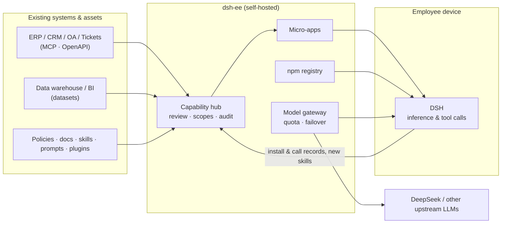

<div align="center">

# dsh-ee

**Your company, inside every employee's Harness**

Connect your ERP, CRM, data warehouse and policy docs, assemble them into AI micro-apps,<br>
and ship them, reviewed and permissioned, to every employee's [DeepSeek Harness (DSH)](https://github.com/deepseek-ai/deepseek-harness).<br>
Data and credentials stay on your own server, and every call can be audited.

English · [简体中文](./README.zh-CN.md) · [Español](./README.es.md) · [Português](./README.pt.md) · [हिन्दी](./README.hi.md)

[](./LICENSE)

### [→ Try the live demo, nothing to install](https://demo.hikariming.com/)


</div>

## Try it

Open [demo.hikariming.com](https://demo.hikariming.com/) and pick an employee of the sample company, Xinghe Tech. No sign-up needed:

- **Zhou Hang, account manager**: see the customers he owns, which contracts are about to expire and who needs a visit, in *Customer visit brief*
- **Chen Yi, expense accountant**: check expense claims and spot over-limit hotels and duplicate invoices in *Travel expense assistant*
- **Zheng Xiaoyu, new hire**: see what to do in the first week in *Onboarding buddy*
- **Liu Yang, IT lead**: see the ticket backlog and common issues in *IT service desk*

You can also sign in as the admin (the account is on the sign-in page) to see how systems are connected, how apps are reviewed and permissioned, and how every call is logged.

The sample company's data is in Chinese.

**Already have DSH?** Run `curl -fsSL https://demo.hikariming.com/setup.sh | sh` (on Windows, `irm https://demo.hikariming.com/setup.ps1 | iex`), pick an employee in the browser to approve the sign-in, then type `/customer-brief` in DSH and ask for a visit brief on 华东精密制造. The demo doesn't provide a model: DSH uses the one you've already set up.

## Three scenarios

| Who | Asks in DSH | What the AI does |
|---|---|---|
| Account manager | "Huadong Precision renews next week. What should I watch out for?" | Calls the CRM: the contract ends in 21 days and there's been no visit in 75 days. Checks the product docs: renewals get at most 10% off, and anything more needs the sales director's approval |
| Expense accountant | "Any problems in this month's expense claims?" | Calls the travel system, lists the 4 flagged claims, and explains each one against the travel policy |
| New hire | "VPN won't connect, it says certificate error" | Walks through the IT troubleshooting guide step by step, and if that doesn't fix it, files a ticket (after asking you to confirm) |

## Who it's for

- **For**: companies, from dozens to thousands of people, whose employees use or will use DeepSeek / DSH, that want the AI to work with their own systems and knowledge, and that worry about data leaks, uncontrolled access and calls nobody can trace.
- **Not for**: personal use; teams that only want a chat page in the browser; companies that don't plan to have employees install DSH on their computers.

## Why dsh-ee

AI tools are easy to come by. What companies lack is a safe way to get **their own** knowledge and systems into every employee's hands.

| Employees using AI tools on their own | With dsh-ee |
|---|---|
| Policies and metric definitions get copy-pasted into chats by hand | Policies, systems and data become capabilities that work as soon as they're installed |
| Plugins and skills come from unknown sources, and nobody reviews them before install | Every package goes through automated checks and admin approval, and access is granted per department |
| No record of who called which system from which machine | Installs and calls are written to the audit log, and anything can be unpublished in one click |
| Useful prompts and workflows stay on one person's laptop | Skills that employees create go back into the company scope for everyone to reuse |

dsh-ee is not an AI runtime. **Inference and tool calls run in each employee's local DSH.** dsh-ee prepares and governs everything DSH needs: capabilities, connections, data, models and policies.

## Features

- **Capability hub**: plugins, skills, prompts, enterprise connections and micro-apps are managed in one place. Each has versions, an access scope (department, role or person) and a delivery mode (auto-enabled or opt-in). Enabled capabilities sync to employees' DSH automatically.
- **Micro-apps**: a persona plus a workbench plus ingredients (knowledge bases, connections, skills, prompts), with optional app-owned tables. Employees open them in DSH with `/name`; apps can also be published as web pages that work on mobile.
- **Enterprise connections (MCP gateway)**: bring in ERP, CRM, ticketing and other internal systems as MCP servers or OpenAPI specs. Credentials are encrypted and kept server-side, never sent to employee machines. Every tool is authorized on its own, and every call is logged.
- **Data hub**: shared datasets in a separate database, queried through a read-only account, with per-user parameters such as `:me_department`. Customers, people, products and other shared reference data live in one place.
- **Knowledge base**: Q&A where every answer cites its sources, with no vector database involved. An agent runs several rounds of keyword search and reads the original documents. Supports PDF, Word and Markdown, with versions and rollback.
- **Built-in npm registry with review**: hosting and publishing for the company scope, per-version review, and automated checks for install scripts, dependencies, licenses and leaked secrets. The company scope never falls back to the public registry, which blocks dependency confusion. Supports preloading packages from upstream and offline bundle import/export.
- **OpenAI-compatible model gateway**: plug in DeepSeek or any other OpenAI-compatible upstream and expose one set of model names. A model can sit on several upstreams with automatic failover. Each account gets a monthly token quota and a list of allowed models.
- **One-command onboarding**: run `curl -fsSL <dsh-ee>/setup.sh | sh` (or `irm <dsh-ee>/setup.ps1 | iex` on Windows) and confirm a device code in the browser. A single unified token (`ee_at_…`) then configures the npm registry, models and capability hub.
- **Third-party harness access**: register an API client (`client_id` / `client_secret`) per integration; CI or another harness exchanges it for a short-lived `ee_at_` token via `client_credentials` instead of holding an admin token. Scopes are capped by the owning account, the secret is stored as a hash and shown once, and every exchange is audited.
- **Identity and governance**: local accounts plus LDAP / AD, RBAC, menus you can edit at runtime, an audit log, and analytics broken down by department, capability, model and endpoint.
- **Runs on domestic infrastructure**: a single static Go binary for linux/amd64 and arm64. Runs on OceanBase or TiDB and works fully offline.

## Architecture

<picture>
  <source media="(prefers-color-scheme: dark)" srcset="docs/images/hero-dark.png">
  
</picture>



dsh-ee is **one binary**: the web UI is embedded, and a single port serves the UI, APIs (`/api`, `/v1`, `/mcp`), the npm registry (`/npm/`) and the DSH plugin index (`/index/dsh-index.json`). It needs a MySQL-protocol database (**OceanBase** in MySQL mode or **TiDB**) and a data directory.

## Quick start

### Offline bundle (recommended)

The target machine only needs Docker and Docker Compose v2. No internet access is required.

```bash
tar xzf dsh-ee-<version>-linux-amd64.tar.gz && cd dsh-ee-<version>-linux-amd64
sha256sum -c SHA256SUMS

./install.sh tidb        # dsh-ee + single-node TiDB
./install.sh oceanbase   # dsh-ee + single-node OceanBase (host needs 2 cores / 8 GB+)
./install.sh external    # dsh-ee only; set DSH_EE_DSN in .env first
```

The first run generates `.env` (master key and initial admin password) and prints the admin password. **Back up `.env` together with the database.** If you lose the master key, the stored upstream credentials can no longer be decrypted.

Build a bundle yourself with `make bundle VERSION=v0.1.0 ARCH=amd64` (or `ARCH=arm64`).

### Docker Compose

```bash
cd deploy
cp ../server/.env.example .env   # set DSH_EE_SECRET_KEY (openssl rand -base64 32) etc.
docker build -t dsh-ee:latest ..
docker compose -f compose.yml -f compose.tidb.yml up -d
```

### Without Docker

```bash
make build                       # → dist/dsh-ee (web UI embedded)
DSH_EE_DSN='root:@tcp(127.0.0.1:4000)/dsh_ee' \
DSH_EE_SECRET_KEY="$(openssl rand -base64 32)" \
DSH_EE_BOOTSTRAP_ADMIN_PASSWORD='change-me-please' \
./dist/dsh-ee
```

A systemd unit is provided in [`deploy/systemd`](./deploy/systemd). HTTPS, reverse proxies and the data hub database are covered in [deploy/README.md](./deploy/README.md) (Chinese).

### Connect employees

On each employee machine:

```bash
curl -fsSL https://<dsh-ee>/setup.sh | sh     # macOS / Linux
irm https://<dsh-ee>/setup.ps1 | iex          # Windows
```

Confirm the device code in the browser, and DSH is connected to the company's capabilities and models. Inside DSH, `/ee-login`, `/ee-status` and `/ee-logout` manage the session.

## Configuration

| Variable | Description |
|---|---|
| `DSH_EE_DSN` | **Required.** MySQL-protocol DSN; the database is created if missing |
| `DSH_EE_SECRET_KEY` | **Required.** 32-byte base64 master key used to encrypt upstream credentials |
| `DSH_EE_ADDR` | Listen address, default `127.0.0.1:8080` |
| `DSH_EE_BOOTSTRAP_ADMIN` / `_PASSWORD` | Admin created when the user table is empty (default user `admin`) |
| `DSH_EE_PUBLIC_URL` | Public URL, e.g. `https://dsh.example.internal`; npm tarball URLs are generated from it |
| `DSH_EE_COOKIE_SECURE` | Force the `Secure` flag on the session cookie; defaults to on when `DSH_EE_PUBLIC_URL` is `https://…` |
| `DSH_EE_DATA_DIR` | Data directory (npm tarballs, caches), default `./data` |
| `DSH_EE_DATA_DSN` / `DSH_EE_DATA_READ_DSN` | Data hub database (writable / read-only); `off` disables the data hub |
| `DSH_EE_LOGIN_IP_LIMIT` / `DSH_EE_LOGIN_IP_WINDOW` | Failed logins allowed per client IP in a fixed window, default `50` per `15m`; `0` / `off` disables |
| `DSH_EE_METRICS` | Set to `true` to expose `GET /metrics` (Prometheus text format, loopback / internal networks only); off by default |
| `DSH_EE_CSP` | Content-Security-Policy mode: `off` (default; only the existing `frame-ancestors` embedding guard), `report` (`Content-Security-Policy-Report-Only`, report only) or `enforce` (`Content-Security-Policy`, block violations). Inline-script hashes are computed from the embedded `index.html` at startup; `frame-ancestors` is merged with `DSH_EE_EMBED_ORIGINS`. Invalid values fail startup. See [docs/operations.md](./docs/operations.md) §10.1 |
| `DSH_EE_CSP_REPORT_URI` | Optional CSP violation report URL (`http(s)://…`); added as `report-uri` when `DSH_EE_CSP` is not `off`. dsh-ee does not ship a collector |
| `DSH_EE_TRUSTED_PROXIES` | Reverse-proxy IPs/CIDRs (comma-separated) whose `X-Forwarded-*` headers are trusted; defaults to loopback only. Set it when the proxy runs in another container/host or behind a cloud LB |
| `DSH_EE_REFRESH_TOKENS` | Opt-in OAuth-style refresh tokens (one-time rotation + reuse detection); default off, so no client behavior changes. When enabled, device/manual issuance also returns an `ee_rt_` refresh token and `POST /api/auth/refresh` is available (404 while off). See [docs/token-lifecycle.md](./docs/token-lifecycle.md) §3 |
| `DSH_EE_REFRESH_ACCESS_TTL` / `_TOKEN_TTL` / `_FAMILY_TTL` / `_GRACE` | Refresh token TTLs and rotation grace: access `1h`, refresh idle `720h`, family cap `4320h`, grace `0` (strict) by default |

The full list is in [server/README.md](./server/README.md).

## Development

Requirements: **Go 1.27+**, **Node 22** with **pnpm**, and a local TiDB or OceanBase.

```bash
# 1. Database: single-node TiDB
tiup playground v8.5.8 --tag dsh-ee --tiflash 0 --without-monitor --host 127.0.0.1

# 2. Server (creates schema and admin on first start)
cd server
cp .env.example .env.local        # fill in DSH_EE_SECRET_KEY and the admin password
set -a; . ./.env.local; set +a
go run ./cmd/dsh-ee

# 3. Web UI (proxies /api, /v1, /npm, /index to :8080)
cd web
pnpm install
pnpm dev                          # http://localhost:5188

# 4. Optional: demo data (roles, employees, quotas, upstreams, a sample micro-app)
cd server && go run ./cmd/seed
```

### Tests

```bash
DSH_EE_TEST_DSN='root:@tcp(127.0.0.1:4000)/' make test   # Go integration tests (random DB per test)
E2E_BASE=http://127.0.0.1:8080 ADMIN_PW=… make e2e      # Playwright end-to-end tests
cd dsh-plugin && npm test                                # DSH connect plugin
```

CI (`.github/workflows/ci.yml`) builds the UI, runs the Go tests against TiDB, runs the end-to-end suite against the single-file build, and builds the image. A separate `oceanbase` workflow repeats this on OceanBase.

### Repository layout

| Path | Contents |
|---|---|
| [`server/`](./server) | Go server: auth, RBAC, LDAP, model gateway, npm registry, capability hub, MCP gateway, knowledge base, data hub |
| [`web/`](./web) | Vite + React + Tailwind UI (shadcn/ui), Chinese and English |
| [`dsh-plugin/`](./dsh-plugin) | `dsh-connect`, the DSH plugin that wires a client to dsh-ee |
| [`deploy/`](./deploy) | Compose files, offline installer, systemd unit |
| [`e2e/`](./e2e) | Playwright tests and real-DSH scenarios |
| [`docs/`](./docs) | Design documents (Chinese) |

## Status

dsh-ee is in early development (v0.x). APIs and schemas may change between releases. Known gaps:

- OIDC login is implemented once an administrator configures an identity provider; local accounts and LDAP / AD also work.
- DSH Desktop distribution reads the official release feeds, verifies sha512, and can mirror installers locally.
- Single-instance oriented: login rate limits, caches and preload jobs live in process memory, and tarballs live on local disk.

See the "Known limitations" section of [server/README.md](./server/README.md) for details.

## Contributing

Issues and pull requests are welcome. Please run the relevant tests before opening a PR. UI strings live in `web/src/i18n/{zh,en}`; the English file must mirror the Chinese structure, and missing keys fail `tsc`.

## License

[Apache License 2.0](./LICENSE)

dsh-ee is an independent project and is not affiliated with DeepSeek.
