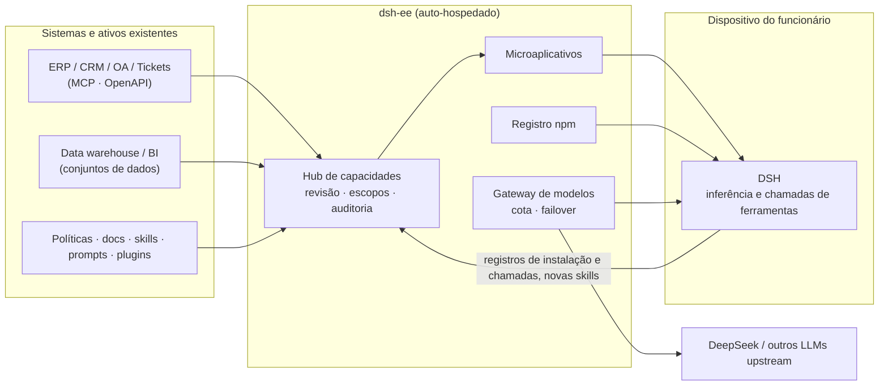

<div align="center">

# dsh-ee

**Sua empresa, dentro do Harness de cada funcionário**

Conecte seu ERP, CRM, data warehouse e documentos de políticas, monte tudo em microaplicativos de IA,<br>
e entregue, revisado e com permissões, ao [DeepSeek Harness (DSH)](https://github.com/deepseek-ai/deepseek-harness) de cada funcionário.<br>
Os dados e as credenciais ficam no seu próprio servidor, e cada chamada pode ser auditada.

[English](./README.md) · [简体中文](./README.zh-CN.md) · [Español](./README.es.md) · Português · [हिन्दी](./README.hi.md)

[](./LICENSE)

### [→ Teste a demo ao vivo, sem instalar nada](https://demo.hikariming.com/)


</div>

## Experimente

Abra [demo.hikariming.com](https://demo.hikariming.com/) e escolha um funcionário da empresa de exemplo, a Xinghe Tech. Não é preciso se cadastrar:

- **Zhou Hang, gerente de contas**: veja os clientes que ele atende, quais contratos estão perto de vencer e quem precisa de uma visita em *Resumo de visitas a clientes*
- **Chen Yi, analista de despesas**: confira as solicitações de reembolso e encontre hotéis acima do limite e notas fiscais duplicadas em *Assistente de despesas de viagem*
- **Zheng Xiaoyu, nova contratação**: veja o que fazer na primeira semana em *Companheiro de onboarding*
- **Liu Yang, líder de TI**: veja a fila de tickets e os problemas mais comuns em *Service desk de TI*

Você também pode entrar como administrador (a conta está na página de login) para ver como os sistemas são conectados, como os aplicativos são revisados e autorizados e como cada chamada é registrada.

Os dados da empresa de exemplo estão em chinês.

**Já tem o DSH?** Execute `curl -fsSL https://demo.hikariming.com/setup.sh | sh` (no Windows, `irm https://demo.hikariming.com/setup.ps1 | iex`), escolha um funcionário no navegador para aprovar o login, depois digite `/customer-brief` no DSH e peça um resumo de visita sobre 华东精密制造. A demo não fornece um modelo: o DSH usa o que você já configurou.

## Três cenários

| Quem | Pergunta no DSH | O que a IA faz |
|---|---|---|
| Gerente de contas | “A Huadong Precision renova na semana que vem. O que devo observar?” | Consulta o CRM: o contrato vence em 21 dias e não há visitas há 75 dias. Consulta a documentação do produto: renovações têm no máximo 10% de desconto, e qualquer desconto maior precisa da aprovação do diretor de vendas |
| Analista de despesas | “Há algum problema nas solicitações de reembolso deste mês?” | Consulta o sistema de viagens, lista as 4 solicitações sinalizadas e explica cada uma com base na política de viagens |
| Nova contratação | “O VPN não conecta, aparece erro de certificado” | Segue o guia de solução de problemas de TI passo a passo e, se isso não resolver, abre um ticket (depois de pedir sua confirmação) |

## Para quem é

- **Para**: empresas de dezenas a milhares de pessoas, cujos funcionários usam ou vão usar DeepSeek / DSH, que querem que a IA trabalhe com os próprios sistemas e conhecimentos, e que se preocupam com vazamento de dados, acessos sem controle e chamadas que ninguém consegue rastrear.
- **Não é para**: uso pessoal; equipes que só querem uma página de chat no navegador; empresas que não pretendem instalar o DSH nos computadores dos funcionários.

## Por que dsh-ee

Ferramentas de IA são fáceis de encontrar. O que falta às empresas é uma forma segura de colocar **o próprio** conhecimento e os próprios sistemas nas mãos de cada funcionário.

| Funcionários usando ferramentas de IA por conta própria | Com o dsh-ee |
|---|---|
| Políticas e definições de métricas são copiadas e coladas nos chats à mão | Políticas, sistemas e dados viram capacidades que funcionam assim que são instaladas |
| Plugins e skills vêm de origens desconhecidas, e ninguém os revisa antes de instalar | Cada pacote passa por verificações automáticas e pela aprovação do administrador, e o acesso é concedido por departamento |
| Não há registro de quem chamou qual sistema a partir de qual máquina | Instalações e chamadas vão para o log de auditoria, e qualquer item pode ser despublicado com um clique |
| Prompts e fluxos úteis ficam no notebook de uma pessoa só | Skills criadas pelos funcionários voltam para o escopo da empresa, e todos podem reutilizá-las |

O dsh-ee não é um runtime de IA. **A inferência e as chamadas de ferramentas rodam no DSH local de cada funcionário.** O dsh-ee prepara e governa tudo o que o DSH precisa: capacidades, conexões, dados, modelos e políticas.

## Recursos

- **Hub de capacidades**: plugins, skills, prompts, conexões corporativas e microaplicativos gerenciados em um só lugar. Cada um tem versões, um escopo de acesso (departamento, papel ou pessoa) e um modo de entrega (ativado automaticamente ou opt-in). Capacidades habilitadas são sincronizadas automaticamente com o DSH dos funcionários.
- **Microaplicativos**: uma persona, um workbench e ingredientes (bases de conhecimento, conexões, skills e prompts), com tabelas próprias opcionais. Os funcionários os abrem no DSH com `/nome`; também podem ser publicados como páginas web que funcionam no celular.
- **Conexões corporativas (gateway MCP)**: traga ERP, CRM, sistemas de tickets e outros sistemas internos como servidores MCP ou especificações OpenAPI. As credenciais são criptografadas e ficam no servidor, e nunca são enviadas às máquinas dos funcionários. Cada ferramenta é autorizada individualmente e cada chamada é registrada.
- **Hub de dados**: conjuntos de dados compartilhados em um banco separado, consultados por meio de uma conta somente leitura, com parâmetros por usuário como `:me_department`. Clientes, pessoas, produtos e outros dados de referência compartilhados ficam em um só lugar.
- **Base de conhecimento**: perguntas e respostas em que cada resposta cita as fontes, sem banco de dados vetorial. Um agente faz várias rodadas de busca por palavras-chave e lê os documentos originais. Suporta PDF, Word e Markdown, com versões e rollback.
- **Registro npm integrado com revisão**: hospedagem e publicação para o escopo da empresa, revisão por versão e verificações automáticas de scripts de instalação, dependências, licenças e segredos vazados. O escopo da empresa nunca recorre ao registro público, o que bloqueia dependency confusion. Suporta pré-carregamento de pacotes de um upstream e importação/exportação de pacotes offline.
- **Gateway de modelos compatível com OpenAI**: conecte o DeepSeek ou qualquer outro upstream compatível com OpenAI e exponha um único conjunto de nomes de modelos. Um modelo pode ficar em vários upstreams com failover automático. Cada conta recebe uma cota mensal de tokens e uma lista de modelos permitidos.
- **Onboarding com um comando**: execute `curl -fsSL <dsh-ee>/setup.sh | sh` (ou `irm <dsh-ee>/setup.ps1 | iex` no Windows) e confirme um código de dispositivo no navegador. Um único token unificado (`ee_at_…`) então configura o registro npm, os modelos e o hub de capacidades.
- **Acesso de Harness de terceiros**: registre um cliente de API (`client_id` / `client_secret`) por integração; a CI ou outro Harness o troca por um token `ee_at_` de curta duração via `client_credentials`, em vez de guardar um token de administrador. Os scopes são limitados pela conta proprietária, o segredo é armazenado como hash e mostrado uma única vez, e cada troca é auditada.
- **Identidade e governança**: contas locais além de LDAP / AD, RBAC, menus editáveis em tempo de execução, log de auditoria e análises por departamento, capacidade, modelo e endpoint.
- **Roda em infraestrutura nacional**: um único binário estático em Go para linux/amd64 e arm64. Roda em OceanBase ou TiDB e funciona totalmente offline.

## Arquitetura

<picture>
  <source media="(prefers-color-scheme: dark)" srcset="docs/images/hero-dark.png">
  
</picture>



O dsh-ee é **um único binário**: a interface web é embutida, e uma única porta serve a interface, as APIs (`/api`, `/v1`, `/mcp`), o registro npm (`/npm/`) e o índice de plugins do DSH (`/index/dsh-index.json`). Ele precisa de um banco com protocolo MySQL (**OceanBase** no modo MySQL ou **TiDB**) e de um diretório de dados.

## Início rápido

### Pacote offline (recomendado)

A máquina de destino só precisa de Docker e Docker Compose v2. Não é necessário acesso à internet.

```bash
tar xzf dsh-ee-<version>-linux-amd64.tar.gz && cd dsh-ee-<version>-linux-amd64
sha256sum -c SHA256SUMS

./install.sh tidb        # dsh-ee + TiDB de nó único
./install.sh oceanbase   # dsh-ee + OceanBase de nó único (o host precisa de 2 núcleos / 8 GB+)
./install.sh external    # só dsh-ee; defina DSH_EE_DSN no .env antes
```

Na primeira execução, o `.env` é gerado (chave mestra e senha inicial do administrador) e a senha do administrador é impressa. **Faça backup do `.env` junto com o banco de dados.** Se você perder a chave mestra, as credenciais de upstream armazenadas não poderão mais ser descriptografadas.

Para montar seu próprio pacote, use `make bundle VERSION=v0.1.0 ARCH=amd64` (ou `ARCH=arm64`).

### Docker Compose

```bash
cd deploy
cp ../server/.env.example .env   # defina DSH_EE_SECRET_KEY (openssl rand -base64 32) etc.
docker build -t dsh-ee:latest ..
docker compose -f compose.yml -f compose.tidb.yml up -d
```

### Sem Docker

```bash
make build                       # → dist/dsh-ee (interface web embutida)
DSH_EE_DSN='root:@tcp(127.0.0.1:4000)/dsh_ee' \
DSH_EE_SECRET_KEY="$(openssl rand -base64 32)" \
DSH_EE_BOOTSTRAP_ADMIN_PASSWORD='change-me-please' \
./dist/dsh-ee
```

Há uma unit do systemd em [`deploy/systemd`](./deploy/systemd). HTTPS, proxies reversos e o banco de dados do hub de dados são tratados em [deploy/README.md](./deploy/README.md) (em chinês).

### Conectar os funcionários

Na máquina de cada funcionário:

```bash
curl -fsSL https://<dsh-ee>/setup.sh | sh     # macOS / Linux
irm https://<dsh-ee>/setup.ps1 | iex          # Windows
```

Confirme o código de dispositivo no navegador, e o DSH fica conectado às capacidades e aos modelos da empresa. Dentro do DSH, `/ee-login`, `/ee-status` e `/ee-logout` gerenciam a sessão.

## Configuração

| Variável | Descrição |
|---|---|
| `DSH_EE_DSN` | **Obrigatório.** DSN com protocolo MySQL; o banco é criado se não existir |
| `DSH_EE_SECRET_KEY` | **Obrigatório.** Chave mestra de 32 bytes em base64 usada para criptografar as credenciais de upstream |
| `DSH_EE_ADDR` | Endereço de escuta, padrão `127.0.0.1:8080` |
| `DSH_EE_BOOTSTRAP_ADMIN` / `_PASSWORD` | Administrador criado quando a tabela de usuários está vazia (usuário padrão `admin`) |
| `DSH_EE_PUBLIC_URL` | URL pública, por exemplo `https://dsh.example.internal`; as URLs dos tarballs npm são geradas a partir dela |
| `DSH_EE_COOKIE_SECURE` | Força a flag `Secure` no cookie de sessão; fica ativada por padrão quando `DSH_EE_PUBLIC_URL` é `https://…` |
| `DSH_EE_DATA_DIR` | Diretório de dados (tarballs npm, caches), padrão `./data` |
| `DSH_EE_DATA_DSN` / `DSH_EE_DATA_READ_DSN` | Banco de dados do hub de dados (gravação / somente leitura); `off` desativa o hub de dados |
| `DSH_EE_LOGIN_IP_LIMIT` / `DSH_EE_LOGIN_IP_WINDOW` | Falhas de login permitidas por IP de cliente em uma janela fixa, padrão `50` a cada `15m`; `0` / `off` desativa |
| `DSH_EE_METRICS` | Defina como `true` para expor `GET /metrics` (formato texto do Prometheus, somente loopback / redes internas); desativado por padrão |
| `DSH_EE_CSP` | Modo do Content-Security-Policy: `off` (padrão; apenas a proteção existente de incorporação via `frame-ancestors`), `report` (`Content-Security-Policy-Report-Only`, apenas reporta) ou `enforce` (`Content-Security-Policy`, bloqueia violações). Os hashes dos scripts inline são calculados a partir do `index.html` embutido na inicialização; `frame-ancestors` é mesclado com `DSH_EE_EMBED_ORIGINS`. Valores inválidos fazem a inicialização falhar. Veja [docs/operations.md](./docs/operations.md) §10.1 |
| `DSH_EE_CSP_REPORT_URI` | URL opcional para relatórios de violação de CSP (`http(s)://…`); adicionada como `report-uri` quando `DSH_EE_CSP` não é `off`. O dsh-ee não inclui um coletor |
| `DSH_EE_TRUSTED_PROXIES` | IPs/CIDRs de proxies reversos (separados por vírgula) cujos cabeçalhos `X-Forwarded-*` são aceitos; o padrão é apenas loopback. Defina quando o proxy roda em outro contêiner/host ou atrás de um LB na nuvem |
| `DSH_EE_REFRESH_TOKENS` | Tokens de refresh opcionais no estilo OAuth (rotação de uso único + detecção de reutilização); desativado por padrão, então o comportamento dos clientes não muda. Quando ativado, a emissão por dispositivo/manual também retorna um token de refresh `ee_rt_` e `POST /api/auth/refresh` fica disponível (404 enquanto desativado). Veja [docs/token-lifecycle.md](./docs/token-lifecycle.md) §3 |
| `DSH_EE_REFRESH_ACCESS_TTL` / `_TOKEN_TTL` / `_FAMILY_TTL` / `_GRACE` | TTLs dos tokens de refresh e margem de rotação: acesso `1h`, refresh ocioso `720h`, teto por família `4320h`, margem `0` (estrita) por padrão |

A lista completa está em [server/README.md](./server/README.md).

## Desenvolvimento

Requisitos: **Go 1.27+**, **Node 22** com **pnpm** e um TiDB ou OceanBase local.

```bash
# 1. Banco de dados: TiDB de nó único
tiup playground v8.5.8 --tag dsh-ee --tiflash 0 --without-monitor --host 127.0.0.1

# 2. Servidor (cria o schema e o administrador na primeira inicialização)
cd server
cp .env.example .env.local        # preencha DSH_EE_SECRET_KEY e a senha do administrador
set -a; . ./.env.local; set +a
go run ./cmd/dsh-ee

# 3. Interface web (faz proxy de /api, /v1, /npm e /index para :8080)
cd web
pnpm install
pnpm dev                          # http://localhost:5188

# 4. Opcional: dados de demonstração (papéis, funcionários, cotas, upstreams e um microaplicativo de exemplo)
cd server && go run ./cmd/seed
```

### Testes

```bash
DSH_EE_TEST_DSN='root:@tcp(127.0.0.1:4000)/' make test   # testes de integração em Go (banco aleatório por teste)
E2E_BASE=http://127.0.0.1:8080 ADMIN_PW=… make e2e      # testes de ponta a ponta com Playwright
cd dsh-plugin && npm test                                # plugin de conexão do DSH
```

A CI (`.github/workflows/ci.yml`) compila a interface, roda os testes em Go contra o TiDB, roda a suíte de ponta a ponta contra o build de arquivo único e constrói a imagem. Um workflow `oceanbase` separado repete isso no OceanBase.

### Estrutura do repositório

| Caminho | Conteúdo |
|---|---|
| [`server/`](./server) | Servidor Go: autenticação, RBAC, LDAP, gateway de modelos, registro npm, hub de capacidades, gateway MCP, base de conhecimento, hub de dados |
| [`web/`](./web) | Interface Vite + React + Tailwind (shadcn/ui), em chinês e inglês |
| [`dsh-plugin/`](./dsh-plugin) | `dsh-connect`, o plugin do DSH que conecta um cliente ao dsh-ee |
| [`deploy/`](./deploy) | Arquivos Compose, instalador offline, unit do systemd |
| [`e2e/`](./e2e) | Testes Playwright e cenários com DSH real |
| [`docs/`](./docs) | Documentos de design (em chinês) |

## Status

O dsh-ee está em desenvolvimento inicial (v0.x). As APIs e os schemas podem mudar entre versões. Lacunas conhecidas:

- O login OIDC está disponível assim que um administrador configura um provedor de identidade; contas locais e LDAP / AD também funcionam.
- A distribuição do DSH Desktop lê os feeds de release oficiais, verifica sha512 e pode espelhar instaladores localmente.
- Orientado a instância única: limites de login, caches e jobs de pré-carregamento ficam na memória do processo, e os tarballs no disco local.

Veja a seção “Known limitations” de [server/README.md](./server/README.md) para mais detalhes.

## Contribuição

Issues e pull requests são bem-vindos. Rode os testes relevantes antes de abrir um PR. Os textos da interface ficam em `web/src/i18n/{zh,en}`; o arquivo em inglês deve espelhar a estrutura do chinês, e chaves ausentes quebram o `tsc`.

## Licença

[Apache License 2.0](./LICENSE)

O dsh-ee é um projeto independente e não é afiliado ao DeepSeek.
