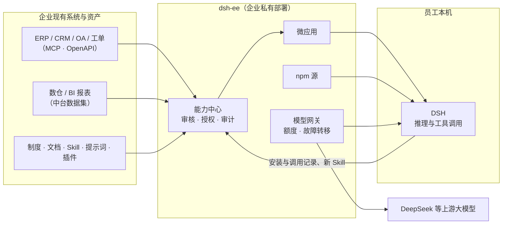

<div align="center">

# dsh-ee

**让每位员工的 DSH 都认识你的公司**

把 ERP、CRM、数仓和制度文档接进来，组装成 AI 微应用，审核授权后送到每位员工的 [DeepSeek Harness（DSH）](https://github.com/deepseek-ai/deepseek-harness)。<br>
数据和凭据都留在你自己的服务器上，每一次调用都可以审计。

[English](./README.md) · 简体中文

[](./LICENSE)

### [→ 在线试一下，不用装任何东西](https://demo.hikariming.com/)


</div>

## 在线试一下

打开 [demo.hikariming.com](https://demo.hikariming.com/)，选一位示例公司「星河科技」的员工就能进去，不用注册：

- **周航 · 客户经理**：在「客户拜访简报」里看自己负责的客户、哪些快到期、谁该去拜访了
- **陈一 · 费用会计**：在「出差报销助手」里核对报销单，找出住宿超标、发票重复的单子
- **郑小雨 · 新员工**：在「新人入职助手」里看第一周要做的事
- **刘洋 · IT 主管**：在「IT 服务台」里看积压的工单和常见故障

也可以用管理员账号登录（登录页上有），看看系统是怎么接入、应用是怎么审核授权的，每次调用又是怎么记下来的。

**已经装了 DSH？** 在终端运行 `curl -fsSL https://demo.hikariming.com/setup.sh | sh`（Windows 用 `irm https://demo.hikariming.com/setup.ps1 | iex`），在浏览器里选一位员工确认登录，然后在 DSH 里输入 `/customer-brief`，问一句「给华东精密制造生成一份拜访简报」。演示站不提供模型，DSH 用的是你自己配好的模型。

## 三个场景

| 谁 | 在 DSH 里问 | AI 做了什么 |
|---|---|---|
| 客户经理 | 「华东精密制造下周续约，我要注意什么？」 | 调 CRM 查到合同 21 天后到期、75 天没有拜访；查产品资料确认续约最多 9 折，再低要销售总监审批 |
| 费用会计 | 「本月报销单里有没有异常？」 | 调差旅系统列出 4 张异常单，按差旅制度逐条说明哪里超标 |
| 新员工 | 「VPN 连不上，提示证书错误」 | 先按 IT 排障手册一步步排查，解决不了再帮你在工单系统里建单（建单前先让你确认） |

## 适合谁

- **适合**：已经让员工用、或者准备让员工用 DeepSeek / DSH 的公司（几十人到几千人都可以），想让 AI 用上公司自己的系统和知识，同时担心数据外泄、权限失控、出了问题查不到。
- **不适合**：个人使用；只想要一个网页聊天框；不打算让员工在自己电脑上装 DSH。

## 为什么是 dsh-ee

AI 工具不缺，缺的是把企业**自己的**知识和系统，安全地送到每位员工手里。

| 员工各自用 AI 工具 | 经 dsh-ee 统一下发 |
|---|---|
| 制度和指标口径靠员工自己复制粘贴进对话 | 制度、系统、数据封装成能力，装上就能直接问 |
| 插件和 Skill 来路不明，装之前没人审过 | 每个包先过自动检查，再由管理员审批、按部门授权 |
| 谁在哪台电脑上调用了什么系统，事后查不到 | 安装与调用记录回流审计，出问题可一键下架 |
| 好用的提示词和流程留在个人电脑里 | 员工沉淀的新 Skill 回到企业作用域，供全员复用 |

dsh-ee 本身不跑 AI：**推理与工具调用都在员工本机的 DSH 里**。dsh-ee 负责把 DSH 需要的能力、连接、数据、模型与策略备好、管住。

## 功能

- **能力中心**：插件、技能、提示词、企业连接、微应用一处管理，每个都有版本、可用范围（部门 / 角色 / 指定人）与下发方式（自动生效 / 自己启用），启用后自动同步到员工的 DSH。
- **微应用**：人设 + 工作台 + 原料（知识库、连接、技能、提示词），可以自带数据表。员工在 DSH 里用 `/名字` 打开；也能发布成网页版，手机上也能用。
- **企业连接（MCP 网关）**：ERP、CRM、工单等内部系统通过 MCP 服务或 OpenAPI 文档接入。凭据加密托管在服务端，不下发到员工电脑；每个工具单独授权，每次调用都有记录。
- **数据中台**：企业共用的数据集放在单独的库里，用只读账号查询，支持 `:me_department` 这类按人取值的参数。客户、人员、产品等主数据只存一份。
- **知识库问答**：不依赖向量模型，Agent 多轮关键词检索、读原文后作答，句句带出处；支持 PDF、Word、Markdown，文档有版本、可回滚。
- **内置 npm 源与审核**：企业作用域的托管与发布、逐版本审核，自动检查安装脚本、依赖、许可证与密钥泄露；企业作用域永不回源，防依赖混淆；支持上游预载与离线包导入导出。
- **OpenAI 兼容模型网关**：接入 DeepSeek 等上游后对外统一模型名，同名模型可挂多个上游自动故障转移，按账号分配月度 token 额度与可用模型。
- **一条命令接入**：`curl -fsSL <dsh-ee>/setup.sh | sh`（Windows 用 `irm <dsh-ee>/setup.ps1 | iex`），浏览器确认设备码后，统一令牌 `ee_at_…` 一次配好 npm 源、模型与能力中心。
- **第三方 Harness 接入**：按集成方注册 API 客户端（`client_id` / `client_secret`），CI 或其它 Harness 用 `client_credentials` 换短期 `ee_at_` 令牌，不必把管理员令牌交给对方；scope 受所属账号权限约束，secret 只存哈希且只显示一次，每次换 token 都有审计。
- **身份与治理**：本地账号与 LDAP / AD、RBAC、可在线调整的菜单、审计日志，以及按部门、能力、模型、终端统计的运营数据。
- **信创友好**：单个 Go 静态二进制（linux/amd64、arm64），数据库用 OceanBase 或 TiDB，支持完全离线部署。

## 架构

<picture>
  <source media="(prefers-color-scheme: dark)" srcset="docs/images/hero-dark.zh-CN.png">
  
</picture>



dsh-ee 是**一个文件**：前端嵌在 Go 二进制里，同一个端口提供界面、接口（`/api`、`/v1`、`/mcp`）、npm 源（`/npm/`）与 DSH 插件索引（`/index/dsh-index.json`）。只依赖一个 MySQL 协议的数据库（**OceanBase** MySQL 模式或 **TiDB**）和一个数据目录。

## 快速开始

### 离线安装包（推荐）

目标机器只需要 docker 与 docker compose v2，不需要外网。

```bash
tar xzf dsh-ee-<版本>-linux-amd64.tar.gz && cd dsh-ee-<版本>-linux-amd64
sha256sum -c SHA256SUMS

./install.sh tidb        # dsh-ee + 单机 TiDB
./install.sh oceanbase   # dsh-ee + 单机 OceanBase（宿主机至少 2 核 8 GB）
./install.sh external    # 只起 dsh-ee，连接已有数据库：先在 .env 里填 DSH_EE_DSN
```

第一次执行会生成 `.env`（主密钥与初始管理员密码），并打印管理员密码。**`.env` 要和数据库一起备份**：主密钥丢了，已存的上游凭据就解不开了。

自己打安装包：`make bundle VERSION=v0.1.0 ARCH=amd64`（鲲鹏等用 `ARCH=arm64`）。

### docker compose

```bash
cd deploy
cp ../server/.env.example .env   # 填 DSH_EE_SECRET_KEY（openssl rand -base64 32）等
docker build -t dsh-ee:latest ..
docker compose -f compose.yml -f compose.tidb.yml up -d
```

### 不用 docker

```bash
make build                       # 产物 dist/dsh-ee，已嵌好前端
DSH_EE_DSN='root:@tcp(127.0.0.1:4000)/dsh_ee' \
DSH_EE_SECRET_KEY="$(openssl rand -base64 32)" \
DSH_EE_BOOTSTRAP_ADMIN_PASSWORD='请改成至少十个字符的密码' \
./dist/dsh-ee
```

systemd 单元在 [`deploy/systemd`](./deploy/systemd)。HTTPS、反向代理、正式环境数据库与数据中台的配置见 [deploy/README.md](./deploy/README.md)。

### 员工接入

在员工电脑上：

```bash
curl -fsSL https://<dsh-ee>/setup.sh | sh     # macOS / Linux
irm https://<dsh-ee>/setup.ps1 | iex          # Windows
```

在浏览器确认设备码后，DSH 就接上了企业的能力与模型。DSH 对话里可用 `/ee-login`、`/ee-status`、`/ee-logout` 管理登录。

- `ee_at_…` 是统一接入令牌，按账号 RBAC 与令牌 scope 取交集控制模型、npm 源、能力中心和企业连接；服务端只保存哈希。旧 `ee_npm_…` 与 `sk-ee-…` 继续兼容。
- 脚本把令牌交给 DSH 凭据库，不默认写入 `.env`。服务器或 CI 可用 `setup.sh --token <令牌>` 或 `DSH_EE_TOKEN`，这条兼容路径仍写 `$DSH_HOME/.env`。
- 升级前请保留原主密钥。回滚到旧服务端后，新 `ee_at_` 令牌不可用，需要重新使用旧令牌；新增表和列不会影响旧版启动。

## 配置

| 环境变量 | 说明 |
|---|---|
| `DSH_EE_DSN` | **必填**。MySQL 协议 DSN；库不存在时会尝试创建 |
| `DSH_EE_SECRET_KEY` | **必填**。32 字节 base64 主密钥，加密上游凭据 |
| `DSH_EE_ADDR` | 监听地址，默认 `127.0.0.1:8080` |
| `DSH_EE_BOOTSTRAP_ADMIN` / `_PASSWORD` | 用户表为空时创建的管理员，默认用户名 `admin` |
| `DSH_EE_PUBLIC_URL` | 对外地址，如 `https://dsh.example.internal`；npm 的 tarball 地址按它生成 |
| `DSH_EE_COOKIE_SECURE` | 会话 cookie 是否加 `Secure`；`DSH_EE_PUBLIC_URL` 为 `https://…` 时默认开启，显式设置可覆盖 |
| `DSH_EE_DATA_DIR` | 数据目录（npm tarball、缓存），默认 `./data` |
| `DSH_EE_DATA_DSN` / `DSH_EE_DATA_READ_DSN` | 数据中台的库（可写 / 只读账号）；设为 `off` 关闭数据中台 |
| `DSH_EE_LOGIN_IP_LIMIT` / `DSH_EE_LOGIN_IP_WINDOW` | 同一客户端 IP 在固定窗口内允许的登录失败次数，默认 `50` 次 / `15m`；设为 `0` / `off` 关闭 |
| `DSH_EE_METRICS` | 设为 `true` 时开放 `GET /metrics`（Prometheus 文本格式，只允许本机 / 内网抓取）；默认关闭 |
| `DSH_EE_CSP` | 内容安全策略模式：`off`（默认，只加现有的 `frame-ancestors` 嵌入收口）/ `report`（`Content-Security-Policy-Report-Only`，只报告不阻断）/ `enforce`（`Content-Security-Policy`，阻断违规）。内联脚本哈希在启动时从嵌入的 `index.html` 计算，`frame-ancestors` 与 `DSH_EE_EMBED_ORIGINS` 合并；非法值启动失败。见 [docs/operations.md](./docs/operations.md) §10.1 |
| `DSH_EE_CSP_REPORT_URI` | 可选的 CSP 违规报告地址（`http(s)://…`）；`DSH_EE_CSP` 不是 `off` 时写进 `report-uri`。dsh-ee 不自带收集端点 |
| `DSH_EE_TRUSTED_PROXIES` | 可信反向代理的地址 / CIDR（逗号分隔），只有它们传来的 `X-Forwarded-*` 会被采信；默认只有本机回环地址。代理在别的机器、容器网络或云负载均衡后面时必填 |

完整列表、权限模型与接口说明见 [server/README.md](./server/README.md)。

## 开发

需要 **Go 1.27+**、**Node 22** 与 **pnpm**，以及一个本地 TiDB 或 OceanBase。

```bash
# 1. 数据库：单机 TiDB（数据保存在 tag dsh-ee 下，下次同样命令会复用）
tiup playground v8.5.8 --tag dsh-ee --tiflash 0 --without-monitor --host 127.0.0.1

# 2. 服务端（首次启动会自动建库、建表、创建管理员）
cd server
cp .env.example .env.local        # 填好 DSH_EE_SECRET_KEY 与管理员密码
set -a; . ./.env.local; set +a
go run ./cmd/dsh-ee

# 3. 前端（Vite 把 /api、/v1、/npm、/index 代理到 :8080）
cd web
pnpm install
pnpm dev                          # http://localhost:5188
```

除落地页与设备确认页外，所有页面都需要登录；账号用服务端首次启动时创建的管理员。

### 演示数据

服务端起来后，可以补一份可直接演示的数据（角色、员工、机器人、额度、上游模型与凭据）：

```bash
cd server
set -a; . ./.env.local; set +a
DSH_EE_SEED_ADMIN_PASSWORD='你的管理员密码' go run ./cmd/seed
```

- 管理员：使用 `admin` 账号写入，所以需要它的密码（也可用 `DSH_EE_SEED_ADMIN_PASSWORD` 显式指定）。
- 角色：「审核员」（看总览 + 审核能力）、「运维」（再加 npm 源与上游预载）。
- 员工：`zhang.wei` / `li.na` / `sun.hao` / `chen.yu` / `zhou.lei` / `wang.fang`，初始密码默认 `dsh-ee-demo-2026`，可用 `DSH_EE_SEED_USER_PASSWORD` 覆盖；其中 `wang.fang` 故意不分配额度，用来演示 429。
- 机器人：`rd-ci`（研发效能部 CI），负责人是 `zhang.wei`，每月 500 万 token，不能登录网页。
- 上游：「DeepSeek（官方）」与「内部模型网关」，`deepseek-flash` 同时挂在两个上游上，用于演示故障转移。
- 业务工作台：只读连接 `ee-catalog`（读 dsh-ee 自己公开的插件索引）和微应用「插件导购」（`plugin-guide`），设计见 [docs/workbench-panels.md](./docs/workbench-panels.md)。
- 凭据：每个演示员工与机器人各一个 `ee_at_`「演示接入」令牌；明文只在第一次创建时打印。

重复执行是幂等的。上游 key 默认是占位值（`sk-demo-*`），连接检查会失败；接真实上游时用 `DSH_EE_SEED_DEEPSEEK_KEY` / `DSH_EE_SEED_GATEWAY_KEY` 传进去。

### 测试

```bash
# Go 集成测试（需要一个 TiDB / OceanBase；每个测试建随机库，跑完删除）
DSH_EE_TEST_DSN='root:@tcp(127.0.0.1:4000)/' make test

# 浏览器端到端测试：对一个已启动的服务（推荐用 make build 的单文件），需要初始管理员密码
E2E_BASE=http://127.0.0.1:8080 ADMIN_PW=… make e2e      # 或 cd e2e && node run.mjs registry 只跑一个

# 接入插件单元测试与真实 DSH 场景（需先 make build，并准备 DSH 与 Chrome）
cd dsh-plugin && npm test
cd e2e/dsh/scenarios && npm test
```

每次推送 GitHub Actions（`.github/workflows/ci.yml`）会构建前端、对 TiDB 跑 Go 集成测试、用嵌好前端的单文件跑全部端到端测试、校验 compose 并构建镜像。`oceanbase` 工作流（手动触发 / 每周一次）在 OceanBase 上再跑一遍，本地也可以用 `scripts/test-oceanbase.sh`（需要 8 GB 以上内存）。

### 前端约定

- 基础组件来自 [shadcn/ui](https://ui.shadcn.com)（Radix），源码在 `web/src/components/shadcn/`；新增组件：`cd web && pnpm dlx shadcn@latest add <组件名>`。
- 确认操作用 `useConfirm()`（`lib/confirm.tsx`），不要用 `window.confirm`；提示消息用 `notify(msg)`（Sonner）。
- 可搜索下拉 `Combobox`、日期选择 `DatePicker` 在 `components/pickers.tsx`；数据表 `DataTable`（TanStack Table）在 `components/data-table.tsx`；悬停提示 `Tip` 在 `components/tip.tsx`。
- 多语言用 `react-i18next`：文案在 `web/src/i18n/zh/*.ts`（源语言）与 `web/src/i18n/en/*.ts`，英文按中文的结构写，缺键会在 `tsc` 时报错。按浏览器语言自动选择，选择记在 localStorage。

### 目录结构

| 路径 | 内容 |
|---|---|
| [`server/`](./server) | Go 服务端：登录与 RBAC、LDAP、模型网关、npm 源、能力中心、MCP 网关、知识库、数据中台 |
| [`web/`](./web) | 前端：Vite + React + Tailwind（shadcn/ui），中英双语 |
| [`dsh-plugin/`](./dsh-plugin) | DSH 接入插件 `dsh-connect` |
| [`deploy/`](./deploy) | compose 文件、离线安装包、systemd 单元 |
| [`e2e/`](./e2e) | Playwright 端到端测试与真实 DSH 场景 |
| [`docs/`](./docs) | 设计文档：[总体设计](./docs/design.md)、[能力中心](./docs/capability-hub.md)、[知识库](./docs/knowledge.md)、[产品 v1](./docs/product-v1.md)、[企业发布与审核](./docs/enterprise-publishing.md) |

<details>
<summary>页面一览（默认菜单，可在「菜单与页面」里改）</summary>

菜单驱动的页面（路由、名称、分组与访问权限都能在「菜单与页面」里改）：

| 分组 | 路径 | 页面 |
|---|---|---|
| 用 | `/apps` | 企业应用：我能用的应用，在 DSH 里打开 |
| 用 | `/knowledge` | 知识问答：制度、手册与资料；在 DSH 的「知识问答」里提问 |
| 用 | `/workbench` | 我的工作台：本月 Token、装过的能力、部门在用、我分享的 |
| 造 | `/build/new` | 新建应用：先做一个自己用的 |
| 造 | `/build` | 我的应用：自己用、分享与审核状态 |
| 造 | `/build/templates` | 从样板复制：从样板和公司已发布的应用复制一个改 |
| 造 | `/build/materials` | 原料：做应用能用的知识库、连接、技能与提示词（高级选项里进「分享插件」） |
| 接入 | `/dsh` | 下载 DSH 核心 / 桌面版 |
| 接入 | `/setup` | 接入指南：一条命令接入企业源 |
| 接入 | `/tokens` | 我的令牌：统一新旧令牌、设备、scope 与用量 |
| 开发 | `/docs` | 开发文档：DSH 插件、dsh-ee 扩展、客户端接入、权限与发布（URL 固定） |
| 开发 | `/examples` | 开发样例：精选 DSH 插件样例的固定版本安装命令、来源与许可（URL 固定） |
| 运营 | `/admin`、`/admin/stats`、`/admin/audit` | 总览、运营数据、审计日志 |
| 账号与权限 | `/admin/users`、`/admin/roles`、`/admin/menus`、`/admin/fields` | 用户、角色与权限、菜单与页面、字段与访问规则 |
| 模型与额度 | `/admin/providers`、`/admin/quotas`、`/admin/tokens` | 模型接入、额度分配、令牌管理 |
| 能力与连接 | `/admin/plugins`、`/admin/review`、`/admin/connections` | 能力管理、待审核、企业连接 |
| 分发与源 | `/admin/distribution`、`/admin/registry`、`/admin/upstream` | DSH 分发、npm 源、上游预载 |
| 系统 | `/admin/brand`、`/admin/auth`、`/admin/settings` | 品牌与外观、登录方式、系统设置（含 LDAP / AD） |

固定页面（不在菜单里，路由不受「菜单与页面」影响）：

| 路径 | 页面 |
|---|---|
| `/`、`/login`、`/go` | 落地页、登录、登录后分流 |
| `/account`、`/device` | 账号与修改密码、设备登录确认 |
| `/assets/new`、`/assets/:id`、`/assets/:id/edit` | 应用 / 能力的新建、详情与编辑 |
| `/plugins/:name` | 插件详情：安装命令、发布预检结果、版本、依赖、README |
| `/knowledge/:id`、`/knowledge/docs/:id` | 知识库详情、文档阅读 |
| `/docs`、`/docs/:slug` | 开发文档列表与详情（固定路由；侧栏入口在「开发」分组） |
| `/examples`、`/examples/:id` | 开发样例列表与详情（固定路由；侧栏入口在「开发」分组） |
| `/a/:slug` | 应用的网页版（手机可用） |
| `/confirm/:id`、`/request`、`/connections/:slug` | 写操作确认、权限申请、按连接标识跳转 |
| `/report/monthly`、`/get-started` | 月度报告、开始使用 |

「分享插件」(`/publish`) 是默认菜单里的隐藏页，入口在「原料 → 高级选项」。「开发」分组的「开发文档」「开发样例」是固定路由：菜单只负责侧栏入口、标题与权限，`/docs`、`/examples` 及详情页的 URL 不随菜单里的 path 变化。`/hub`、`/market`、`/keys`、`/admin/keys` 是旧地址，会自动跳到对应的新页面。

</details>

## 项目状态

dsh-ee 处于早期开发阶段（v0.x），版本之间接口与表结构可能变化。已知缺口：

- OIDC 登录已实现（管理员配置身份提供方后可用）；本地账号与 LDAP / AD 也可用。
- DSH 本体分发已接入官方发布 feed，安装包校验 sha512，并可镜像到本地。
- 按单实例设计：登录限流、缓存与预载任务在进程内存里，tarball 存在本地磁盘。

详见 [server/README.md](./server/README.md) 的「已知限制」。

## 参与贡献

欢迎提 Issue 和 Pull Request。提 PR 前请跑一下相关测试；界面文案请同时改 `web/src/i18n/zh` 与 `web/src/i18n/en`。

## 许可证

[Apache License 2.0](./LICENSE)

dsh-ee 是独立项目，与 DeepSeek 官方无隶属关系。
